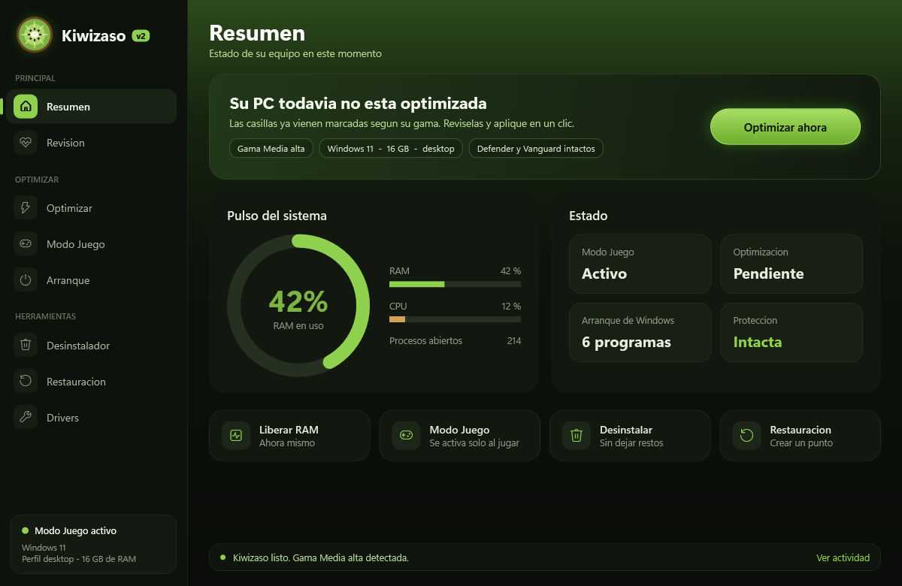
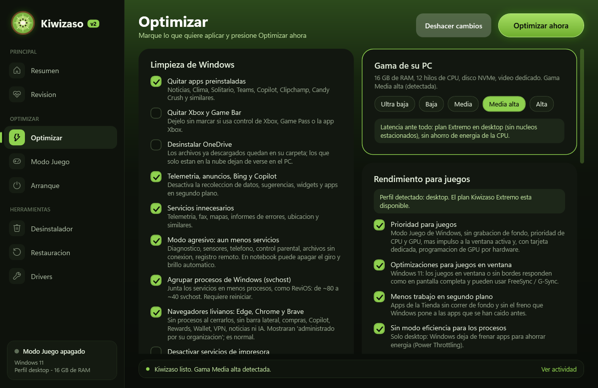
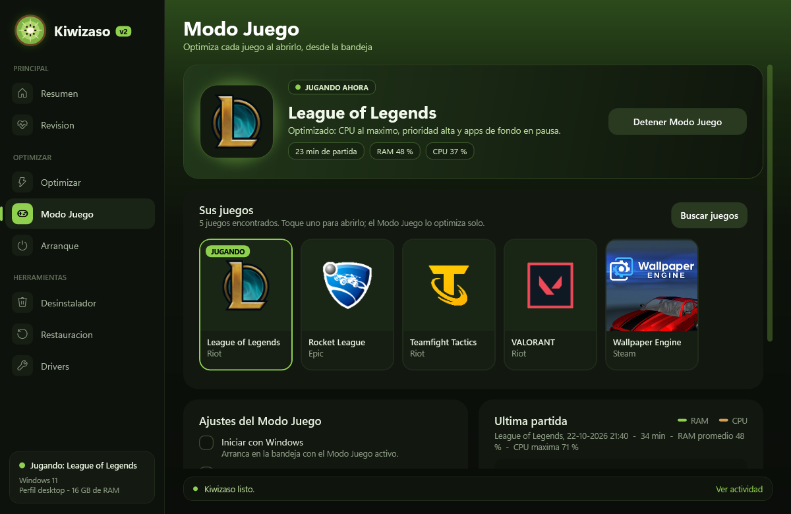
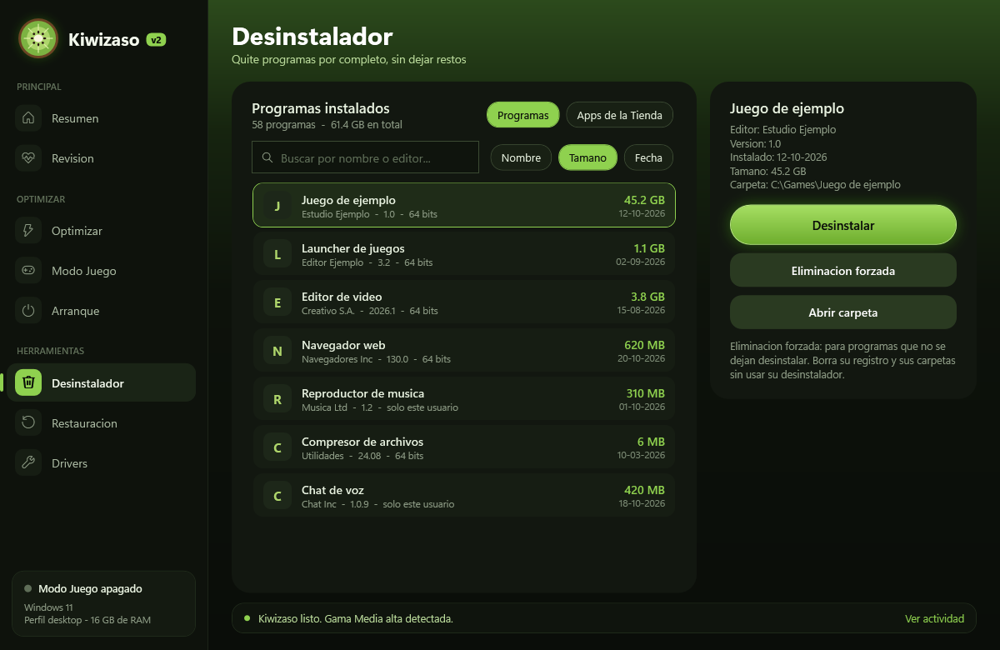
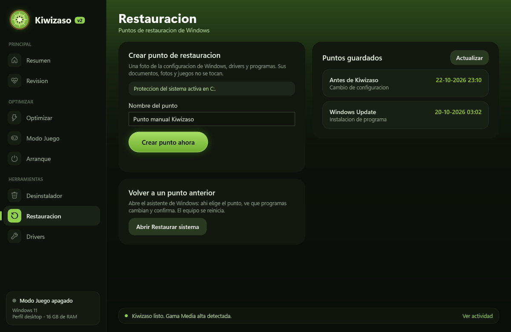

# 🥝 Kiwizaso

Kiwizaso deja Windows 10 y 11 listo para jugar: recorta lo que sobra, ajusta el sistema según la gama de tu PC y detecta tus juegos para optimizar cada partida sola. Todo se hace desde una app con interfaz gráfica y todos los cambios se pueden deshacer.

## Descarga y uso

1. Descarga **`Kiwizaso.exe`**.
2. Haz doble clic y acepta el permiso de administrador.
   - Si Windows muestra "Windows protegió su PC", elige *Más información* → *Ejecutar de todas formas*. El aviso aparece porque el archivo no está firmado.
3. Revisa las casillas, que ya vienen marcadas según tu gama, y presiona **Optimizar ahora**.
4. Reinicia el equipo.

Antes de aplicar cualquier cambio se crea un punto de restauración. El respaldo propio de la app queda en `C:\Kiwizaso\respaldo.json` y el botón **Deshacer cambios** vuelve todo atrás.

> Úsalo solo en tu computador personal, nunca en un equipo de trabajo.

## Qué trae

**Piloto automático**

- Con un interruptor, Kiwizaso decide solo: usa tu gama, elige el modo de optimización, marca los programas de arranque que sobran, ajusta el Modo Juego y lo deja activo con Windows. Antes de aplicar la optimización te pregunta.
- Cada semana borra temporales antiguos y avisa si el disco se está llenando, nunca durante una partida. Funciona sin internet.
- **Optimizar ahora** desde el inicio, con barra de progreso y aviso al terminar.

**Puntaje de salud y recomendaciones**

- Al abrir la app, Kiwizaso revisa tu equipo y le da un puntaje de 0 a 100. Descuenta si aún no optimizas, por cada aviso de la revisión, por los programas que arrancan con Windows y si el Modo Juego está apagado.
- "Recomendado para usted" muestra hasta 4 avisos, cada uno con un botón para resolverlo.

**Gama detectada sola: ultra baja, baja, media, media alta y alta**

La gama se calcula con la RAM, los hilos de CPU, el tipo de disco (HDD, SSD o NVMe) y si hay tarjeta de video dedicada. Cada gama marca sus ajustes recomendados:

- En equipos modestos se recorta todo al mínimo y se mantienen SysMain y la compresión de memoria, que ahí ayudan.
- En equipos potentes la prioridad es la latencia.

**Optimizar**

- Tres modos: **Seguro** (solo ajustes que se deshacen por completo y no cambian cómo se ve ni cómo se usa Windows), **Recomendado** (lo que marca tu gama) y **Competitivo** (todo para latencia y FPS).
- Cada opción es un interruptor con barras de 1 a 3 que indican el impacto esperado en juegos, y el botón dice cuántos cambios se aplicarán.
- **Limpieza de disco** por categorías con su tamaño real: temporales, caché de Windows Update, caché de navegadores y Papelera, con botón **Limpiar ahora**.
- Quita apps preinstaladas, telemetría, anuncios, Bing y Copilot, y deshabilita servicios innecesarios.
- Agrupa los procesos svchost: de ~80 a ~40.
- Aplica prioridad de CPU y GPU para juegos y más impulso a la ventana activa (`Win32PrioritySeparation` en 0x26).
- Activa las optimizaciones para juegos en ventana, la programación de GPU por hardware (solo con tarjeta dedicada) y desactiva el Power Throttling en desktop.
- Usa planes de energía Kiwizaso, con un plan Extremo para desktop. En notebooks aplica máximo rendimiento enchufado y ahorro con batería.

**Modo Juego**

- Muestra tu biblioteca con los logos y portadas de tus juegos de Steam, Epic y Riot. Toca un juego para abrirlo.
- Detecta solo cualquier juego que abras desde Steam, Epic, Riot, Xbox, EA, Ubisoft o GOG, aunque no esté en ninguna lista.
- Mientras juegas, muestra qué estás jugando, el tiempo de partida y la RAM y la CPU en vivo.

Queda en la bandeja del sistema y, al detectar un juego:
- activa el plan de máximo rendimiento y sube la prioridad del juego;
- cierra o baja la prioridad de las apps de fondo;
- pausa Windows Update;
- libera RAM solo cuando hace falta;
- opcionalmente, deja los navegadores y launchers en un solo núcleo para que el resto del procesador sea del juego, y bloquea la tecla Windows.

Cada una de estas acciones tiene su propio interruptor.

Discord y Spotify nunca se tocan.

**Desinstalador**

- Lista los programas y las apps de la Tienda, con buscador y orden por nombre, tamaño o fecha.
- Después de desinstalar, busca las carpetas y claves de registro que quedaron y te deja elegir qué borrar.
- Incluye **eliminación forzada** para los programas que no se dejan desinstalar.
- Las carpetas van a la Papelera y el registro se respalda en `.reg` antes de borrarse.

**Restauración**

- Crea puntos de restauración cuando quieras, sin el límite de uno cada 24 horas.
- Muestra los puntos guardados.
- **Volver aquí** en cada punto (reinicia el equipo) y **Deshacer todos los cambios de Kiwizaso**.
- Abre el asistente de Windows para volver a uno anterior.

**Arranque**

- Cada programa que arranca con Windows trae una sugerencia: quitar o mantener (audio, video, periféricos, seguridad y Discord se mantienen).
- Botones **Marcar sugeridos** y **Quitar marcados**; todo vuelve con Deshacer cambios.

**Revisión y Drivers**

- Avisa si la RAM está sin XMP/EXPO o si el driver de video es antiguo.
- Si el monitor está bajo sus Hz máximos, **Poner X Hz** lo sube en un clic. También avisa si el cable del monitor va a la placa madre y no a la tarjeta de video.
- Detecta ajustes de reloj dañinos que dejan otros programas (`useplatformclock`, `disabledynamictick`) y ofrece repararlos.
- Abre la página oficial de NVIDIA, AMD o Intel para bajar el driver correcto.

## Lo que Kiwizaso NO toca

No toca Windows Defender, SmartScreen, Firewall, UAC, las actualizaciones de seguridad, las mitigaciones del procesador (Spectre/Meltdown), TPM ni Secure Boot. Riot Vanguard exige estos dos últimos para jugar LoL y Valorant.

Tampoco aplica tweaks que las mediciones muestran como placebo o dañinos: HPET o `disabledynamictick` en bcdedit, `NetworkThrottlingIndex`, desactivar el archivo de paginación ni vaciar la RAM a cada rato.

La guía completa en español está en [`LEEME.txt`](LEEME.txt).

## Licencia y uso

Kiwizaso se entrega tal cual, sin garantía. Úsalo bajo tu propio riesgo.
